# Zelo

## Descrição da solução
Zelo é uma aplicação mobile desenvolvida em Flutter que permite aos cidadãos registrar, apoiar e acompanhar ocorrências de zeladoria urbana na sua região (como buracos em vias, problemas de acessibilidade e falhas na iluminação pública). 

Quando uma ocorrência atinge o patamar mínimo de apoio comunitário (80%), o sistema gera automaticamente um ofício formal em PDF que poderá ser direcionado à prefeitura.

## Tema da Global Solution
O projeto alinha-se aos Objetivos de Desenvolvimento Sustentável (ODS) da ONU, focando em cidades e comunidades sustentáveis ao promover uma gestão urbana participativa e transparente.

## Fluxo de telas
1. **Splash & Onboarding**: Tela inicial de apresentação do app com opção de pular.
2. **Feed principal**: Lista todas as ocorrências reportadas, permitindo buscar por título/endereço e filtrar por categorias.
3. **Detalhes da ocorrência**: Exibe informações completas, progresso do apoio comunitário, botão para apoiar e linha do tempo com o histórico da solicitação.
4. **Cadastro de ocorrência**: Formulário para relatar um problema com foto, descrição, categoria e busca automática de endereço via CEP.
5. **Mapa e rotas**: Mapa interativo com as ocorrências sinalizadas e ferramenta de trajeto (a pé ou de carro) que identifica problemas localizados ao longo do caminho.
6. **Ofícios públicos**: Lista os ofícios formais gerados a partir das metas atingidas, com opções de visualizar, imprimir ou baixar o PDF.

## Prints das telas
| | |
|:---:|:---:|
| 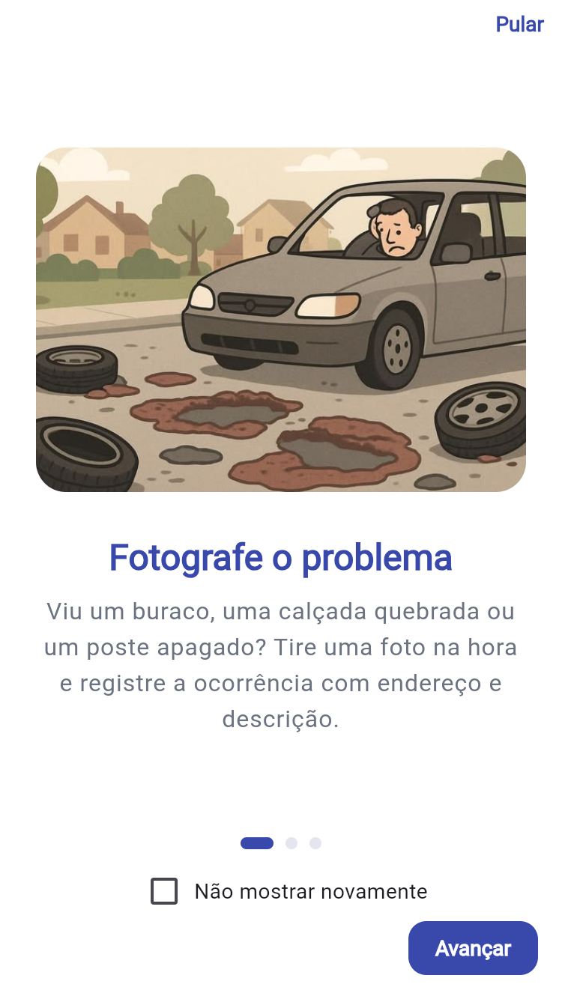 | 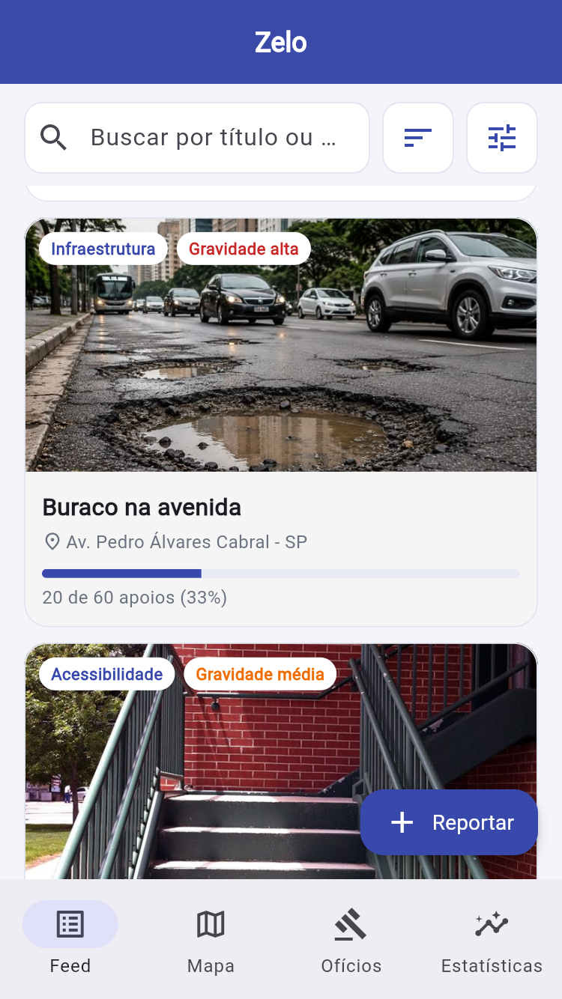 |
| 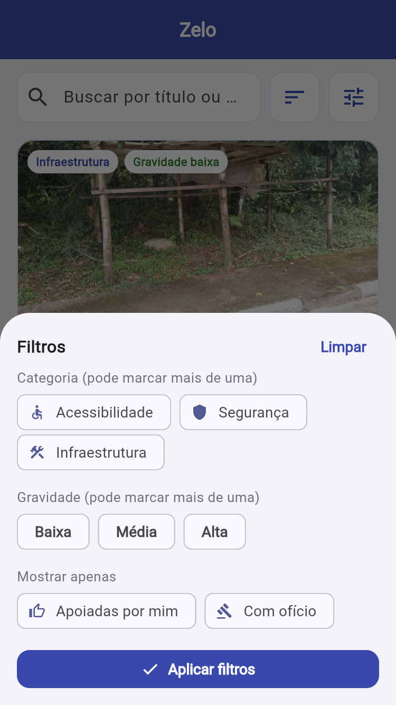 | 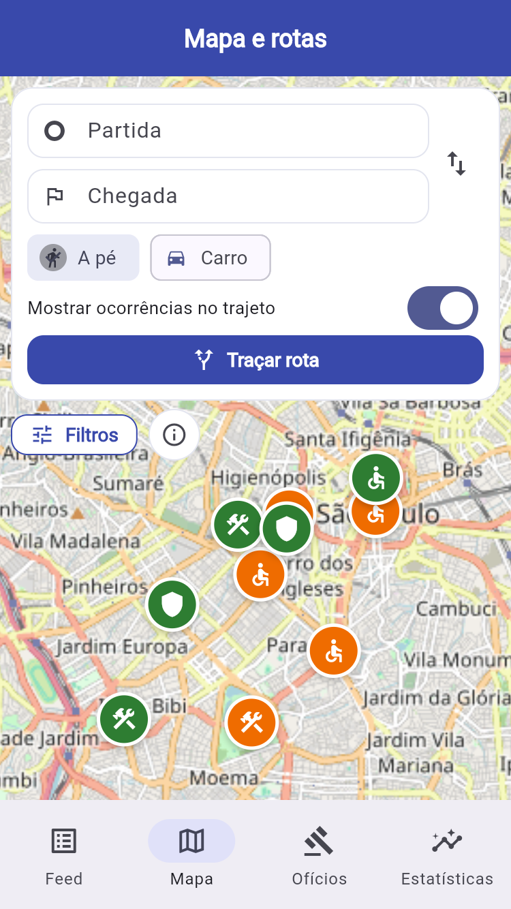 |
| 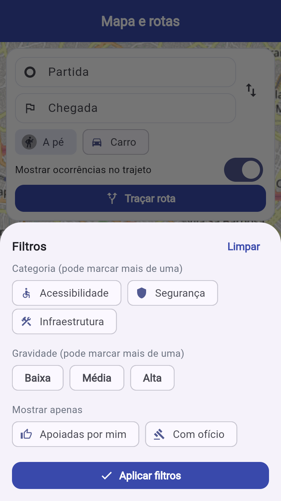 | 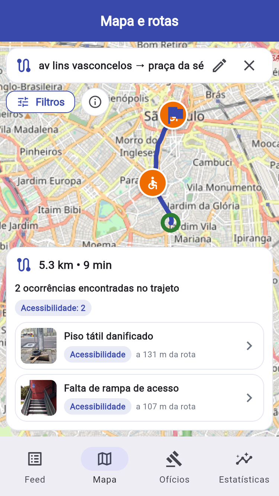 |
| 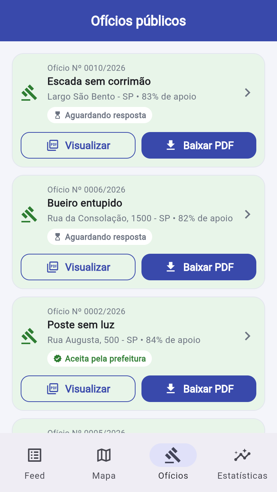 | 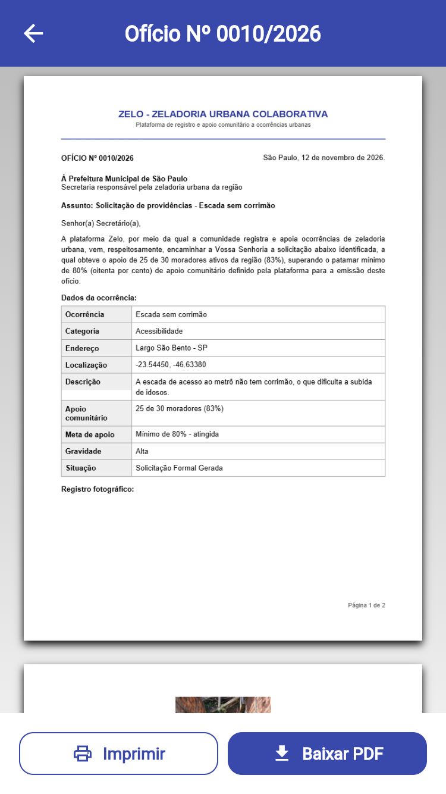 |
| 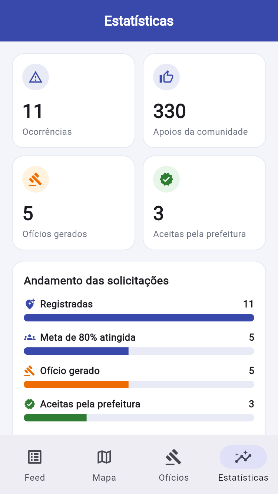 | 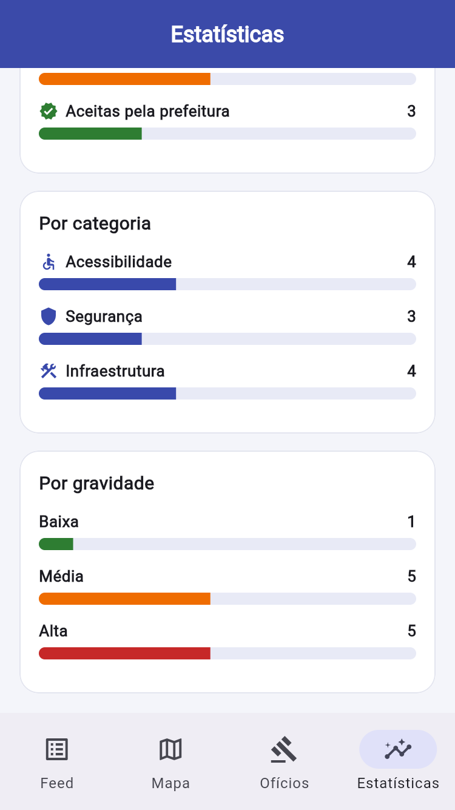 |
| 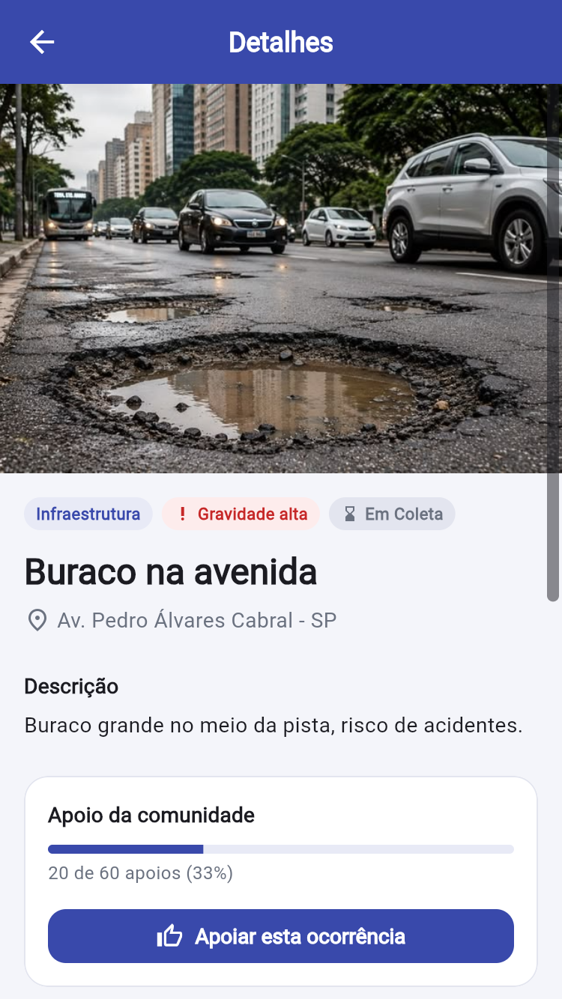 |  |
| 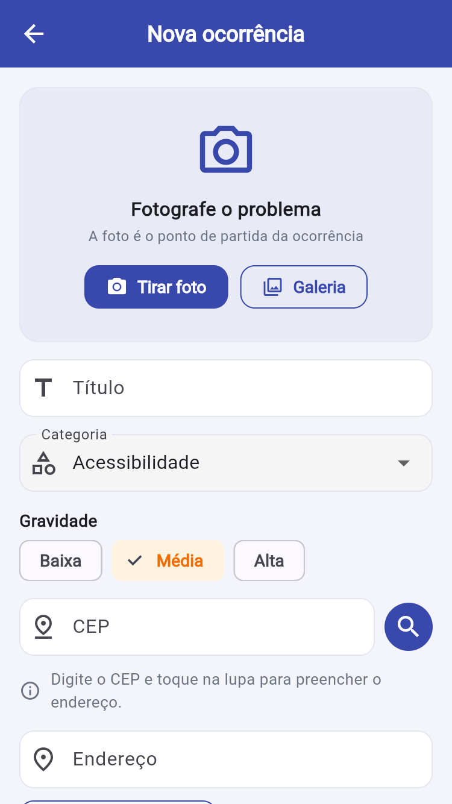 | 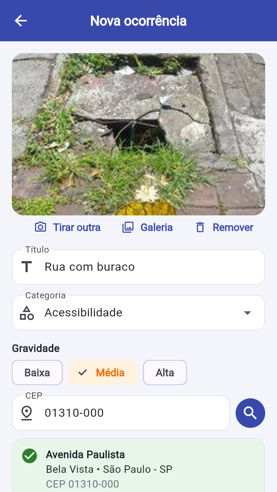 |
| 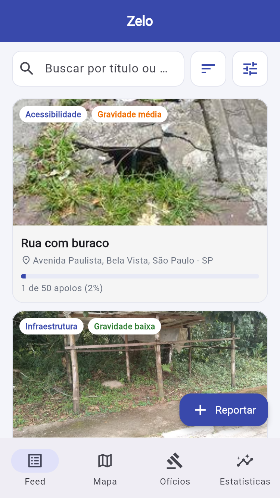 | 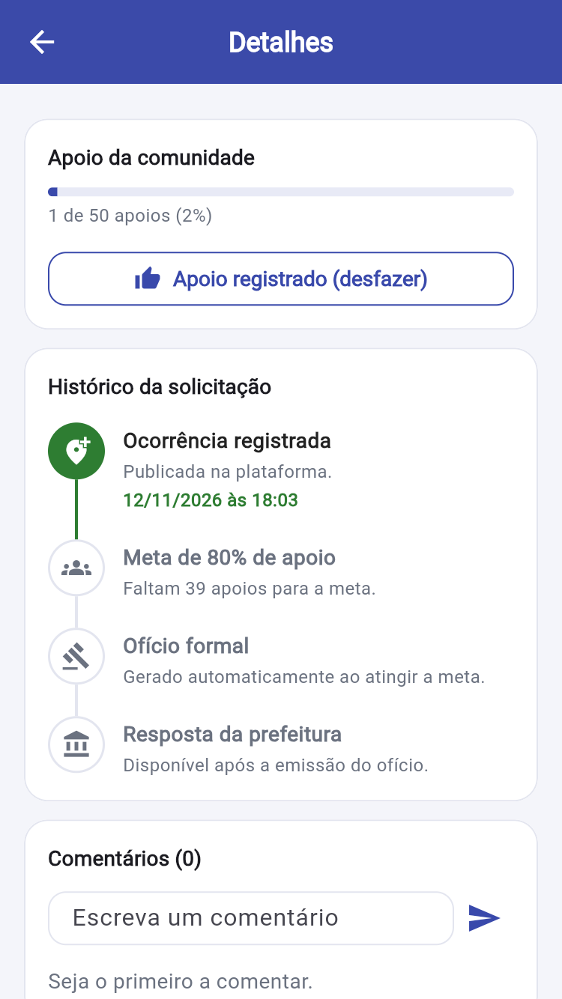 |
| | |

## API utilizada
* **ViaCEP**: API pública REST para consulta automática de endereços através do CEP informado no cadastro.
* **Nominatim (OpenStreetMap)**: Serviço de geocodificação para conversão de endereços em coordenadas geográficas.
* **OSRM (Open Source Routing Machine)**: API de roteamento para cálculo de rotas de pedestres e veículos.

## Explicação da arquitetura
O projeto segue uma arquitetura limpa e modularizada em Flutter:
* **Models**: Definição das estruturas de dados do aplicativo (ocorrências, histórico, rotas, endereços).
* **Repositories**: Camada responsável pela regra de negócios, filtros e comunicação com o banco de dados.
* **Database**: Persistência local utilizando SQLite (`sqflite`), garantindo funcionamento offline e armazenamento de ocorrências e dados iniciais (seed).
* **Services**: Camadas de integração com APIs externas (ViaCEP, OSRM, motor de geração de PDFs).
* **UI / Widgets**: Componentes visuais reutilizáveis organizados por telas e elementos de interface limpos.

## Desenvolvedor(es)
Desenvolvido por:
* RM559049 - Anaí Villca Rojas
* RM557686 - Matheus Amaral de Camargo Cardoso Lima

## Vídeo pitch
[Clique aqui para assistir ao vídeo pitch do projeto](pendente)